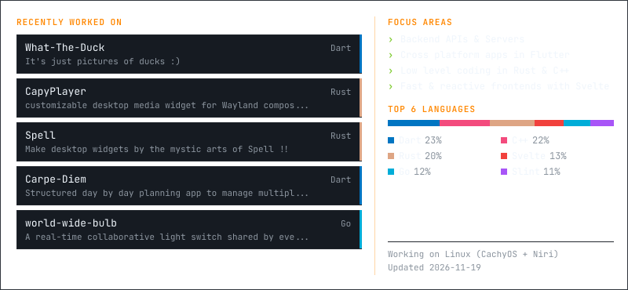

# Sem Van Broekhoven [`dotsem.be ↗`](https://dotsem.be)

Fullstack developer · Making software someone may ever need · Belgium

<picture>
  <source media="(prefers-color-scheme: dark)" srcset="./profile-card-dark.svg">
  <source media="(prefers-color-scheme: light)" srcset="./profile-card-light.svg">
  
</picture>

<a href="https://dotsem.be/projects"><picture><source media="(prefers-color-scheme: dark)" srcset="./buttons/projects-dark.svg"><source media="(prefers-color-scheme: light)" srcset="./buttons/projects-light.svg"></picture></a> <a href="https://dotsem.be/blog"><picture><source media="(prefers-color-scheme: dark)" srcset="./buttons/blog-dark.svg"><source media="(prefers-color-scheme: light)" srcset="./buttons/blog-light.svg"></picture></a> <a href="https://dotsem.be/#contact"><picture><source media="(prefers-color-scheme: dark)" srcset="./buttons/contact-dark.svg"><source media="(prefers-color-scheme: light)" srcset="./buttons/contact-light.svg"></picture></a>

